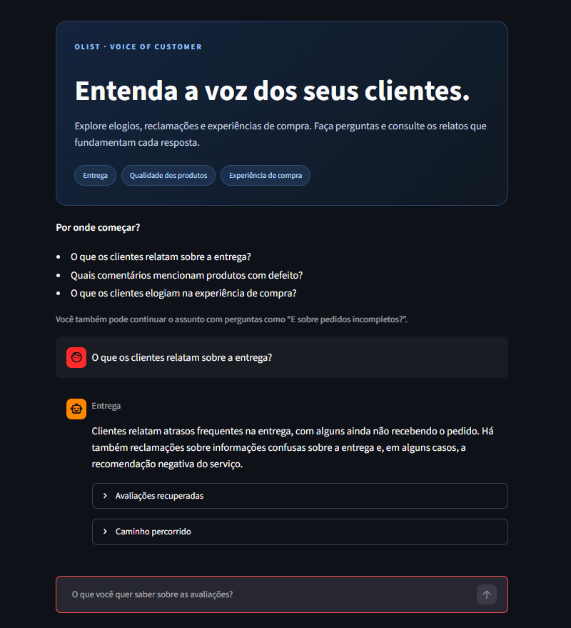
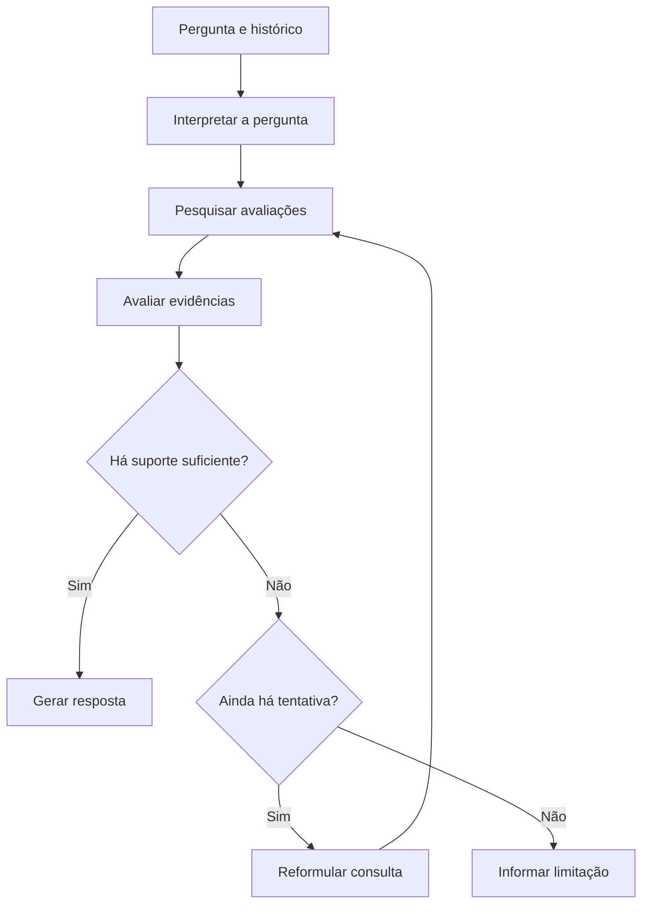

# Olist Voice of Customer Intelligence

### Explore a voz dos clientes com IA Generativa e respostas fundamentadas em avaliações reais.

Aplicação conversacional que permite investigar elogios, reclamações e experiências de compra presentes nas avaliações do **Brazilian E-Commerce Public Dataset by Olist**.

O usuário faz perguntas em linguagem natural, e a aplicação recupera comentários relevantes, avalia se existem evidências suficientes e produz uma síntese acompanhada das avaliações consultadas.

O projeto reúne **RAG, LangChain, LangGraph e Pydantic**, com uma interface em **Streamlit** para conversar com a base e acompanhar o processamento de cada pergunta.

> Desenvolvido para o Tech Challenge da Fase 4 da pós-graduação em AI Scientist da FIAP.

---

## Aplicação em funcionamento



*Consulta às avaliações de clientes, com acesso aos comentários
recuperados e à trilha de execução do LangGraph.*

---

## Problema de negócio

Avaliações de clientes contêm informações importantes sobre atrasos, qualidade dos produtos, atendimento e experiência de compra. Entretanto, consultar esses relatos individualmente dificulta a exploração de grandes volumes de texto.

Esta solução permite que gestores e analistas investiguem esses assuntos por meio de perguntas, mantendo acesso aos comentários recuperados para conferir as respostas.

**Exemplos de investigação:**

- O que os clientes relatam sobre problemas na entrega?
- Quais comentários mencionam pedidos incompletos?
- O que os clientes elogiam na experiência de compra?
- Quais relatos abordam a qualidade dos produtos?

A aplicação realiza uma exploração qualitativa dos comentários recuperados. Não substitui uma análise estatística de toda a base.

---

## Funcionalidades

- **Consulta em linguagem natural:** perguntas sobre as experiências relatadas pelos clientes.
- **Histórico de conversa:** interpretação de perguntas de continuidade, como “E sobre esses problemas?”.
- **Busca semântica:** recuperação de comentários relacionados à necessidade de informação.
- **Avaliação das evidências:** verificação do suporte disponível antes de gerar a resposta.
- **Reformulação da busca:** nova tentativa quando o contexto inicial é insuficiente.
- **Resposta estruturada:** organização do resultado em assunto e resposta.
- **Exibição dos comentários:** acesso às avaliações recuperadas e aos seus metadados.
- **Trilha de execução:** visualização das etapas percorridas pelo fluxo.
- **Tratamento de limitações:** encerramento com mensagem de insuficiência quando não há suporte para responder.
- **Interface web e terminal:** duas formas de utilizar o chatbot.

---

## Demonstração de uso

**Usuário**
> O que os clientes relatam sobre a entrega?

**Assistente — exemplo ilustrativo**
> Nos comentários recuperados, aparecem relatos de atraso, pedidos ainda não recebidos e informações confusas sobre a entrega.

**Usuário**
> E sobre pedidos incompletos?

O histórico permite interpretar a segunda pergunta como uma continuação do assunto. A aplicação realiza uma nova busca e responde com base nos comentários recuperados para essa consulta.

Na interface, cada resposta pode ser acompanhada por:

- **Avaliações recuperadas:** conteúdo, título, nota, fonte e identificador do registro.
- **Caminho percorrido:** interpretação, buscas, avaliação das evidências e geração da resposta.

As respostas variam conforme os comentários recuperados e a saída do modelo.

---

## Arquitetura

A preparação da base ocorre antes das consultas:

1. Leitura do CSV processado.
2. Criação dos documentos e metadados.
3. Divisão dos textos em trechos.
4. Geração dos embeddings.
5. Construção do índice vetorial FAISS.

Durante a conversa, o LangGraph organiza o seguinte fluxo:



### Responsabilidade de cada componente

| Componente | Responsabilidade |
|---|---|
| LangChain | Conectar prompts, modelos e etapas de processamento |
| LangGraph | Controlar a sequência, as decisões e as tentativas de busca |
| Pydantic | Definir e validar a estrutura das saídas do modelo |
| Hugging Face Embeddings | Representar textos e consultas como vetores |
| FAISS | Indexar os vetores e recuperar trechos semelhantes |
| Groq | Disponibilizar o modelo de linguagem por API |
| Streamlit | Apresentar a conversa, os comentários e a trilha de execução |
| Pandas | Ler e organizar os dados utilizados pela aplicação |

---

## Dados e preparação

**Fonte:** [Brazilian E-Commerce Public Dataset by Olist](https://www.kaggle.com/datasets/olistbr/brazilian-ecommerce)

A preparação dos dados está organizada no notebook:

`notebook/01_preparacao_dados.ipynb`

A aplicação utiliza o arquivo:

`dados/processed/dados_rag.csv`

### Campos utilizados

| Campo | Utilização |
|---|---|
| `review_comment_message` | Conteúdo principal da avaliação |
| `review_comment_title` | Informação complementar sobre o relato |
| `review_score` | Nota atribuída pelo cliente |

Na criação dos documentos, comentários vazios são ignorados. Cada documento recebe os metadados de título, nota, arquivo de origem e identificador do registro.

O identificador utilizado corresponde ao índice da linha no CSV processado. Ele permite localizar o registro nessa versão do arquivo, mas pode mudar se o CSV for reorganizado.

Os detalhes das transformações e da seleção dos dados devem ser consultados no notebook.

---

## Configuração do pipeline

| Parâmetro | Configuração |
|---|---|
| Modelo de linguagem | `openai/gpt-oss-20b`, via Groq |
| Temperatura | `0` |
| Modelo de embeddings | `sentence-transformers/paraphrase-multilingual-MiniLM-L12-v2` |
| Execução dos embeddings | CPU |
| Normalização dos embeddings | Ativada |
| Banco vetorial | FAISS |
| Tamanho dos trechos | 650 caracteres |
| Sobreposição | 150 caracteres |
| Recuperação | Até 10 trechos por busca |
| Limite de buscas | 2 por pergunta |

### Decisões técnicas

- **Embeddings multilíngues:** escolhidos para trabalhar com comentários e perguntas em português.
- **FAISS local:** permite executar a busca vetorial sem provisionar um serviço externo de banco de dados.
- **Sobreposição de trechos:** preserva parte do contexto entre segmentos de comentários mais longos.
- **Saídas estruturadas:** facilitam o consumo das respostas pela interface e pelas decisões do grafo.
- **Avaliação antes da resposta:** busca reduzir respostas sem apoio nos comentários.
- **Limite de tentativas:** evita ciclos indefinidos de reformulação.
- **Histórico para interpretação:** esclarece referências da conversa; as evidências da resposta vêm dos comentários recuperados.

A validação com Pydantic verifica a estrutura dos dados. Ela não garante, por si só, a correção factual das respostas.

---

## Estrutura do projeto

```text
olist-voice-of-customer-rag/
├── imagens/
│   └── aplicacao-streamlit.png
├── dados/
│   ├── raw/
│   └── processed/
│       └── dados_rag.csv
├── notebook/
│   └── 01_preparacao_dados.ipynb
├── src/
│   └── main.py
├── .env.example
├── .gitignore
├── app.py
└── README.md
```

| Local | Conteúdo |
|---|---|
| `dados/raw/` | Dados originais |
| `dados/processed/` | Dados preparados para a aplicação |
| `notebook/` | Análise e preparação da base |
| `src/main.py` | Documentos, embeddings, prompts, modelos estruturados e grafo |
| `app.py` | Interface conversacional em Streamlit |
| `.env.example` | Exemplo das variáveis de ambiente necessárias |

O ambiente virtual `.venv/`, o arquivo `.env` e os diretórios `__pycache__/` são locais e não devem ser versionados.

---

## Instalação e execução

### 1. Preparar o ambiente

Na pasta do projeto, crie um ambiente virtual:

```bash
python -m venv .venv
```

Ative o ambiente conforme o sistema utilizado.

**Windows — Prompt de Comando:**

```bat
.venv\Scripts\activate.bat
```

**Linux ou macOS:**

```bash
source .venv/bin/activate
```

### 2. Instalar as dependências

```bash
python -m pip install --upgrade pip
python -m pip install streamlit pandas python-dotenv pydantic langchain-core langchain-groq langchain-community langchain-text-splitters langchain-huggingface langgraph sentence-transformers faiss-cpu
```

Para executar o notebook de preparação:

```bash
python -m pip install jupyter
```

Caso o notebook utilize outras bibliotecas de análise ou visualização, instale também as dependências indicadas nos seus imports.

### 3. Configurar a API

Crie um arquivo `.env` na raiz do projeto, utilizando o `.env.example` como referência:

```env
GROQ_API_KEY=sua_chave_groq
```

A chave deve permanecer apenas no ambiente local ou no mecanismo de segredos da hospedagem.

### 4. Disponibilizar os dados

Verifique se o arquivo processado está em:

```text
dados/processed/dados_rag.csv
```

O CSV deve conter as colunas:

```text
review_comment_message
review_comment_title
review_score
```

Se o arquivo processado não estiver disponível, obtenha a base original e execute o notebook de preparação, conferindo os caminhos de leitura e exportação.

### 5. Executar a interface web

Na raiz do projeto:

```bash
python -m streamlit run app.py
```

Abra o endereço informado no terminal.

Na primeira inicialização, o carregamento do modelo de embeddings e a indexação dos comentários podem levar mais tempo. Na interface, os recursos são reutilizados pelo cache durante a execução da aplicação.

### 6. Executar pelo terminal

```bash
python src/main.py
```

Digite uma pergunta para iniciar a conversa ou `sair` para encerrar.

---

## Roteiro de validação

| Cenário | Pergunta | Comportamento a verificar |
|---|---|---|
| Consulta temática | O que os clientes relatam sobre a entrega? | Síntese apoiada nos comentários recuperados |
| Continuidade | E sobre pedidos incompletos? | Interpretação da pergunta no contexto da conversa |
| Mudança de assunto | Agora quero saber sobre a qualidade dos produtos. | Busca direcionada ao novo tema |
| Experiências positivas | O que os clientes elogiam na experiência de compra? | Uso de relatos que sustentem os elogios |
| Estatística geral | Qual é o percentual de clientes insatisfeitos em toda a base? | Reconhecimento de que a recuperação não permite calcular esse percentual |
| Fora do escopo | Como preparar um bolo de cenoura? | Mensagem de insuficiência de evidências |

A validação deve incluir a leitura das avaliações recuperadas, verificando se cada afirmação da resposta encontra suporte nos registros.

---

## Limitações

- A busca semântica recupera um conjunto limitado de trechos, não uma amostra estatística representativa.
- As respostas não permitem determinar frequências, percentuais ou rankings de toda a base.
- A recuperação pode omitir comentários relevantes ou retornar textos semelhantes entre si.
- As notas complementam a análise, mas não explicam sozinhas o motivo da satisfação ou insatisfação.
- O modelo pode produzir generalizações ou interpretações incorretas, mesmo com instruções de restrição.
- A avaliação de evidências também utiliza um modelo de linguagem e pode falhar.
- Os identificadores dos trechos são locais a cada busca.
- O histórico da conversa não é persistido em um banco de dados.
- A execução depende da disponibilidade da API Groq e dos recursos locais para embeddings e indexação.

As avaliações exibidas correspondem ao contexto recuperado. Sua apresentação permite conferência manual, mas não constitui uma validação automática de cada afirmação gerada.

---

## Próximas evoluções

- Persistir o índice vetorial para reduzir o tempo de inicialização.
- Comparar estratégias de recuperação semântica e híbrida.
- Implementar filtros explícitos por nota e outros metadados.
- Criar um conjunto de avaliação com perguntas e evidências esperadas.
- Medir relevância da recuperação, fidelidade das respostas e latência.
- Acrescentar análises quantitativas para perguntas sobre frequência na base completa.

---

## Autoria

Desenvolvido por **Renan Assis Trevelim**.

Projeto acadêmico e de portfólio voltado à aplicação de IA Generativa na análise da voz do cliente.

A base pública é disponibilizada pela Olist. Este projeto é independente e não representa um produto oficial da empresa.
